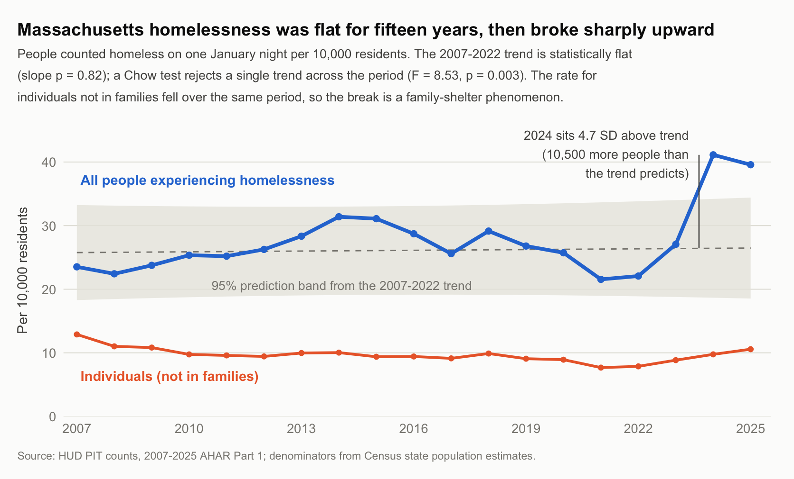

# Massachusetts homelessness, 2007–2025: a level break, not a rising trend

**What this is.** A policy memo and the code that produces every number in it. The
analytical point is general even if the subject is not: a headline metric rose 87%,
and decomposing it showed the aggregate was hiding a *decline* in one of its two
components. The memo draws a hard line between what the data support and what they
cannot — which is the part worth reading if you are here to see how I reason rather
than to learn about Massachusetts.

**The finding.** The usual framing — homelessness has been rising for a decade —
does not fit this state. Massachusetts had **no detectable upward trend from 2007 to
2022**, and then the count jumped 89% in two years. Those are different problems with
different instruments: a drifting series points at housing supply and subsidy, a
level break in a right-to-shelter state points at intake capacity, eligibility rules
and surge financing.



**Read the memo:** [`docs/memo.md`](docs/memo.md) · [Word version](docs/Memo%20-%20Massachusetts%20Homelessness.docx)

## What the analysis establishes

| Finding | Evidence |
|---|---|
| The pre-2023 period is flat, not slow-rising | Slope +0.04 per 10,000 per year (SE 0.17, p = 0.82, R² = 0.004) over 2007–2022 |
| 2024 is a genuine departure, not noise | Predicted 26.4 per 10,000 (95% PI 18.7–34.2), actual 41.1 — 4.7 residual SD above trend, ≈10,500 people |
| The break is 2024, not 2023 | 2023 (27.1) falls inside its band of 18.8–34.0; 2024 and 2025 fall outside |
| One trend does not fit the period | Chow test, F(2,15) = 8.53, p = 0.003 |
| The rise is families entering shelter | Families are 89.6% of the 2022–2024 increase; sheltered 96.4%; chronic individuals 3.1%; veterans 0.1% |
| It is not a general deterioration | Homelessness among individuals *fell*: −0.12 per 10,000 per year, p = 0.006 |
| A housing-cost account does not fit | Rent does not check household composition, yet the two series move in opposite directions |
| The surge sits exactly inside the entitlement | Massachusetts guarantees shelter only to families with children and pregnant women; single adults are excluded. The boundary of the surge and the boundary of the legal right coincide |

That last row is a consistency test, not an identification. Two mechanisms fit it
equally well — family homelessness genuinely rose and the entitlement made it
visible, or the entitlement shaped where demand landed — and a 19-point single-state
series cannot separate them. The memo says so explicitly rather than letting the
coincidence do causal work it cannot do.

## Running it

```bash
python3 src/00_fetch.py          # HUD + Census -> data/*.csv   (see note below)
Rscript  src/build_data.R        # join counts to population, compute rates
Rscript  src/analysis.R          # every statistic quoted in the memo
Rscript  src/figure.R            # the figure
python3  src/make_memo_docx.py   # docs/memo.md -> the Word version
```

Run from the repository root. R needs `readr`, `dplyr` and `ggplot2`; `analysis.R`
prints the R and package versions it ran under as its last section. The Python steps
need `pandas`, `pyxlsb`, `certifi` and `python-docx`.

**Why one step is Python.** HUD publishes the Point-in-Time counts only as `.xlsb`
(binary Excel), and the R reader for that format has no build for the R version this
was written against. Rather than commit hand-made CSVs with no provenance, the
extraction lives in `src/00_fetch.py` and the R scripts take over from the files it
writes. `python3 src/00_fetch.py --check` rebuilds to a temporary directory and
diffs against the committed data instead of overwriting it — so the claim that the
committed CSVs came from the published sources is checkable, not asserted.

`src/analysis.R` prints the headline change, the decomposition of the 2022–2024
increase, the pre-break trend with its out-of-sample predictions, the Chow test, the
counterpoint series and the environment — in that order, each labelled. Running it is
how you check the memo rather than trust it.

```
data/   ma_pit_2007_2025.csv          HUD PIT counts, Massachusetts, 19 state-years
        ma_pop.csv                    Census population estimates (rate denominators)
        ma_homelessness_analysis.csv  the joined, rate-adjusted file
src/    00_fetch.py, build_data.R, analysis.R, figure.R, make_memo_docx.py
docs/   memo.md (the source of truth) and the generated .docx
output/ the figure
```

`docs/memo.md` is the source of truth for the memo; the Word file is generated from
it by `make_memo_docx.py`, so the two cannot drift apart.

## Data

HUD Point-in-Time counts from the 2025 Annual Homelessness Assessment Report, Part 1
([huduser.gov](https://www.huduser.gov/portal/datasets/ahar.html)). The unit of
observation is a state-year: one count on one January night, broken down by shelter
status, household type, chronicity and veteran status.

Denominators are U.S. Census Bureau state population totals, which splice three
vintages (2000–2010 intercensal, Vintage 2020, Vintage 2025). That introduces small
discontinuities at the 2010 and 2020 boundaries — noted in the memo rather than
smoothed away.

Two data notes worth knowing before reusing these files. `chronic` is empty before
2011, a real definitional gap in the HUD series rather than a loading error. And
families plus individuals do not always sum to the total: HUD counts a third
household type, people in households with only children, which is non-zero once
(16 people in 2021). `00_fetch.py` asserts both of these rather than silently
reconciling them.

## What would change this reading

If the January 2026 count returns to the 18.5–34.4 band implied by the pre-2023
trend, the break was a transient intake surge. If it holds near 40 per 10,000,
Massachusetts has a new baseline. The memo commits to that test in advance.

The strongest available extension is a comparison group: New York and the District
of Columbia carry comparable shelter entitlements and most states do not. If
right-to-shelter jurisdictions broke in 2024 and otherwise-similar states did not,
the institutional explanation gains real support.

## Context

Written for **API-232: Computational Policy Analysis**, Harvard Kennedy School,
Fall 2026, and extended afterwards. Licensed under the [MIT License](LICENSE).
