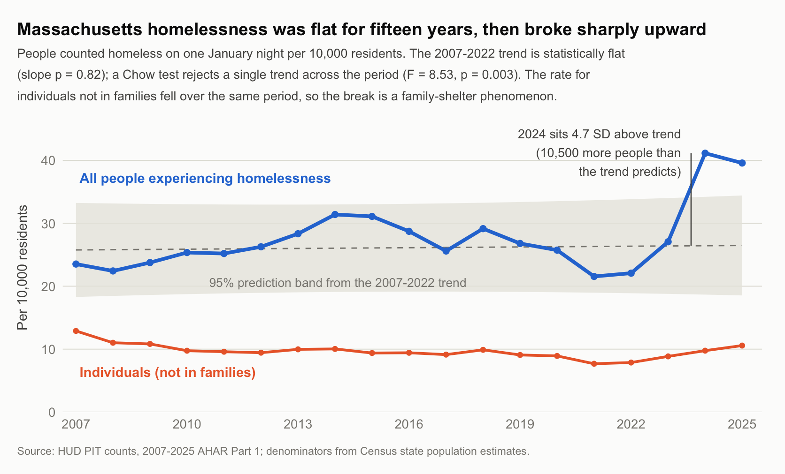

# MEMORANDUM

**To:** Governor of Massachusetts

**From:** Shashwat Singh

**Date:** September 16, 2026

**Re:** Homelessness in Massachusetts, 2007–2025 — a level break, not a rising trend

---

## Bottom line

Massachusetts homelessness did **not** drift upward over two decades. It was flat
from 2007 to 2022, then rose 89% in two years — and the increase is almost entirely
families entering shelter (89.6%), while homelessness among individuals *fell* over
the same period. The 2024 count sits 4.7 standard deviations above what the
preceding fifteen years predict, roughly 10,500 more people than trend.

That structure matters for what the Commonwealth should do. A slow housing-cost
drift would call for supply and subsidy instruments. A discrete level break
concentrated in the one population holding a statutory shelter entitlement calls
instead for **intake capacity, eligibility administration and surge financing** — and
for separating family and individual homelessness in public reporting, because the
aggregate number currently conceals a decline.

**This memo does not establish what caused the break.** It establishes what the
break looks like, which population it sits in, and what it would take to attribute
it. Those are different claims and are kept separate throughout.

## Question and why it matters

Has homelessness in Massachusetts risen steadily over the past two decades, or did
something discrete happen recently? The distinction carries different policy
responses. A gradual rise tracking housing costs points to supply and subsidy
instruments. A sudden level shift in a state with a statutory right to shelter for
families points instead to intake capacity, eligibility rules and surge financing.
Massachusetts is one of only three U.S. jurisdictions guaranteeing shelter — alongside
New York, under the *Callahan v. Carey* consent decree, and the District of Columbia,
under the Homeless Services Reform Act — so the question is live rather than academic.

## Data and unit of observation

US Department of Housing and Urban Development (HUD) Point-in-Time (PIT) counts,
published in the 2025 Annual Homelessness Assessment Report, Part 1 (huduser.gov).
This is the most recent release available at the time of writing; the January 2026
count is not yet published. The unit of observation is a state-year: a single count
of people experiencing homelessness on one night each January. That yields 19 annual
observations for Massachusetts, 2007–2025, each broken down by shelter status
(sheltered / unsheltered), household type (in families / individuals), chronicity
and veteran status. Rates use Census Bureau state population estimates as
denominators.

## Analysis

The count rose from 15,127 in 2007 to 28,311 in 2025 — up 87%, or 68% per capita
(23.5 to 39.6 per 10,000 residents). That headline conceals the structure. Across
2007–2022 the rate averaged 26.1 per 10,000 (standard deviation 3.0, range
21.6–31.4) with no direction at all. Almost the entire increase arrives in two
years: the count rose 89% from 2022 to 2024 (15,507 to 29,360), then eased to
28,311 in 2025. The increase of 13,853 people decomposes as:

| Component | Change, 2022–2024 | Share of the increase |
|---|---:|---:|
| People in families | +12,418 | 89.6% |
| Sheltered | +13,353 | 96.4% |
| Chronically homeless individuals | +426 | 3.1% |
| Veterans | +16 | 0.1% |

Two further facts sharpen this. Homelessness among individuals not in families fell
over the full period, from 12.9 to 10.6 per 10,000, a statistically significant
decline (−0.12 per 10,000 per year, p = 0.006). Massachusetts remains almost
entirely sheltered: 6.2% of its 2025 count was unsheltered against 35.7%
nationally, the second-lowest share among 54 states and territories, behind only
New York. Both states are large right-to-shelter jurisdictions.

## Testing trend against break

Because the question is precisely whether the series follows a trend or shifts
level, I fit a linear trend to 2007–2022 only (n = 16) and tested the later years
against it. This is a description of the series' structure, not a causal model, and
it is reported as such.

The pre-2023 slope is +0.04 per 10,000 per year (SE 0.17; p = 0.82; R² = 0.004):
year explains essentially none of the variation, so the earlier period is flat
rather than merely slow-rising. Extrapolating that trend predicts 26.4 per 10,000
for 2024, with a 95% prediction interval of 18.7–34.2. The actual value is 41.1 —
outside that interval, 4.7 residual standard deviations above the prediction, about
10,500 more people than the trend implies. A Chow test rejects a single trend across
the period (F(2,15) = 8.53, p = 0.003). Note that 2023 itself (27.1) falls inside
its band of 18.8–34.0: the break is 2024, not 2023. The break year was fixed before
fitting, on institutional grounds rather than by searching the series for its
largest jump.

## The apparent contradiction, and what resolves it

On its face the data contradict the standard account. If rising housing costs were
driving the increase, individuals and families should both be rising: rent does not
check household composition. Instead the two series move in opposite directions —
families up 124% from 2022 to 2024, individuals down over the full period. A
general housing-affordability story does not fit that pattern, and this analysis is
sufficient to say so.

What does fit is the boundary of the entitlement. Massachusetts guarantees shelter
under the 1983 Emergency Assistance statute **only to families with children under 21
and to pregnant women; single adults are excluded.**¹ The boundary of the surge and
the boundary of the legal right therefore coincide exactly:

| | Right to shelter | 2022–2024 change |
|---|---|---|
| Families with children, pregnant women | **Yes** (EA entitlement) | **+124%** |
| Individuals without children | No | Declining over the full period |

Two mechanisms are consistent with that alignment, and **this data cannot separate
them**. Either family homelessness genuinely rose and the entitlement made it
visible by drawing people into a system that counts them, or the entitlement itself
shaped where demand landed. Both predict exactly what we observe.

The same boundary also qualifies the measurement. In a right-to-shelter state, PIT
counts the entitled population well — they are in shelter, enumerated on a register —
and the non-entitled population poorly, since unsheltered counts rest on street
canvasses. Part of the divergence between the two series may therefore be a
difference in how completely each is observed, not only a difference in what
happened to each.

## Recommendations

1. **Treat the break as a capacity and intake problem in the short run, not evidence
   of a general housing collapse.** The individual series rules out a broad
   deterioration in housing hardship over this period.
2. **Do not read the 2025 decline as resolution.** At 39.6 per 10,000, 2025 remains
   4.2 standard deviations above the pre-2023 trend. The level has come down
   slightly; it has not returned.
3. **Report family and individual homelessness separately** in Commonwealth
   reporting. The aggregate figure moved 87% while one of its two components fell —
   any briefing that quotes only the total misstates the problem.
4. **Commission the comparison-group analysis before attributing cause.** New York
   and the District of Columbia carry comparable entitlements; most states do not. If
   right-to-shelter jurisdictions broke in 2024 and otherwise-similar states did not,
   the institutional explanation gains real support. That analysis is a week of work
   on data already public.
5. **Treat the January 2026 count as the test.** See below.

## What would change this reading

If the January 2026 PIT count returns to the 18.5–34.4 band implied by the
pre-2023 trend, the break was a transient intake surge and should be managed as
one. If it holds near 40 per 10,000, Massachusetts has a new baseline, and
capacity built as emergency response needs to be put on a permanent footing.

Equally, if a comparison-group analysis showed non-entitlement states breaking in
2024 at similar magnitude, the right-to-shelter explanation offered above would be
substantially weakened, and a national cause would be the better candidate.

## Interpretation

**Supported by these data.** Massachusetts had no detectable upward trend in
homelessness from 2007 to 2022, so the common framing that homelessness has been
rising for a decade does not fit this state. The increase is a discrete level shift
in 2024, distinguishable from trend at conventional significance. Families are
overwhelmingly entering shelter, while chronic and individual homelessness were
close to unaffected. The divergence between the family and individual series is
sufficient to reject a general housing-affordability account of this period.

**Not established by the data.** This analysis does not identify the cause of the
increase. The timing coincides with large asylum-seeker arrivals meeting the state's
right-to-shelter obligation, and the 2025 decline follows tightened Emergency
Assistance eligibility. However, a single-state series of 19 points cannot attribute
the break to either. Doing so would require a comparison group (other states, or the
other right-to-shelter jurisdictions) and covariates for housing costs, mortgage
rates and labor markets. Separately, a right-to-shelter system converts hidden
homelessness into counted and sheltered homelessness, so part of the measured rise
may reflect enrolment in a system rather than new hardship. The HUD PIT data cannot
separate the two.

**Measurement limits.** PIT data captures one January night and so misses episodic
homelessness across the year (AHAR Part 2 annual counts would be needed).
Unsheltered figures rest on street canvasses with a known undercount, so
year-to-year movements in that series are the least reliable component. Population
denominators splice three Census vintages (2000–2010 intercensal, Vintage 2020,
Vintage 2025), introducing small discontinuities at the 2010 and 2020 boundaries.
The prediction intervals above assume independent, normally distributed errors,
which an annual series with persistence will not strictly satisfy; the true
intervals are somewhat wider. The 2024 departure is large enough — 4.7 standard
deviations — that this does not change the conclusion.

---

¹ Massachusetts Emergency Assistance program, established 1983. See
[Mass Legal Help, *Emergency Assistance: Basic shelter rights for families*](https://www.masslegalhelp.org/housing-apartments-shelter/emergency-shelter/emergency-assistance-basic-shelter-rights-families)
and the [Massachusetts Municipal Association fact sheet](https://www.mma.org/wp-content/uploads/2023/10/Emergency-Shelter_Fact-Sheet-FAQ-Sept-2023.pdf).

**Sources.** HUD, 2025 AHAR Part 1, PIT Counts by State 2007–2025
(huduser.gov/portal/datasets/ahar). U.S. Census Bureau, State Population Totals
(NST-EST2025, nst-est2020, st-est00int). Analysis in R; scripts and the extracted
Massachusetts series accompany this memo.
